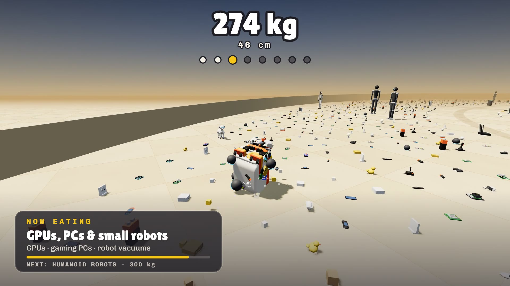

# 🦆 Microduck Ball

A duck-sized, [Katamari Damacy](https://en.wikipedia.org/wiki/Katamari_Damacy)-inspired game: skate, roll up gadgets and robots, grow bigger, and topple the giant duck. Built with JavaScript and Three.js.

[Play Microduck Ball](https://microduck-ball.andriil.chatgpt.site)



## Run locally

```bash
python3 -m http.server 8790
```

Open [localhost:8790](http://localhost:8790). Use **WASD** or arrow keys to move, **Shift** for turbo, and **P** to pause.

Duck model, animation, and synth sounds come from [Microduck Fight](https://github.com/1204al/microduck_fight_game).
